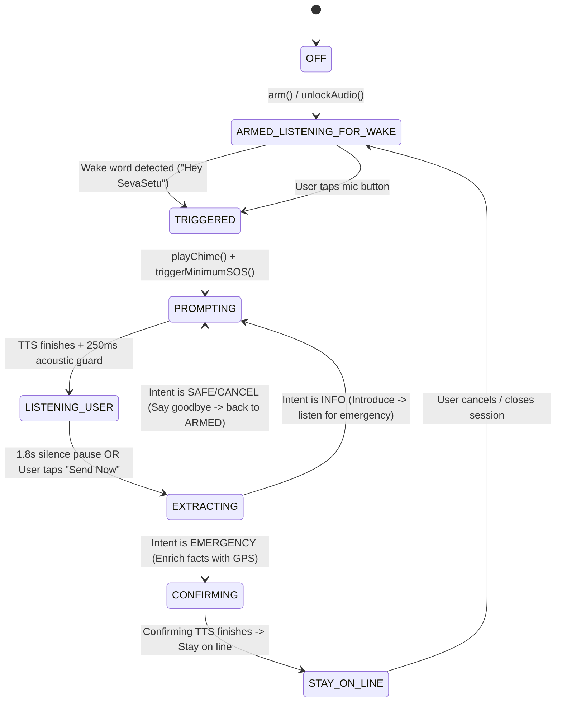

# SevaSetu Voice Emergency Architecture (Deterministic Rebuild)

## 1. Executive Architecture Overview

SevaSetu replaces fragmented, multi-instance Web Speech API and native speech hooks with a single, deterministic, state-machine-driven architecture modeled after modern conversational voice systems (ChatGPT / Gemini voice mode).

### Core Invariants
1. **Single Recognition Owner**: Exactly **ONE** speech recognition engine (`VoiceController`) controls microphone access across the entire app. No competing instances, preventing browser tab recording dot flickering and Chromium `DOMException: recognition has already started`.
2. **Half-Duplex Guard**: The assistant never speaks and listens simultaneously. The speech recognition stream is unconditionally stopped during TTS playback, followed by a mandatory **250ms acoustic settling guard** before audio input hardware re-opens. This completely eliminates self-hearing and speaker echo.
3. **Golden Law (SOS First, NLP Second)**: A deterministic minimum emergency record (`POST /api/emergency/trigger`) with idempotent UUID `clientEventId` is stored locally and dispatched **before** awaiting NLP or ASR completion. Network, GPS, or AI failure never blocks or gates SOS creation.
4. **Deterministic Safety Floor & Urgency Monotonicity**: AI can only **raise** incident urgency, never lower it. Fire and trapped signals clamp urgency to `10.0`; injury signals clamp urgency to minimum `8.0`. Monotonicity is mathematically enforced on every fact update:
   $$\text{Urgency}_{\text{new}} = \max(\text{Urgency}_{\text{current}}, \text{Urgency}_{\text{incoming}})$$

---

## 2. State Machine (Finite State Transducer)



### State Descriptions
- `OFF`: Voice engine is inactive.
- `ARMING`: Pre-warming `AudioContext`, querying permissions.
- `ARMED_LISTENING_FOR_WAKE`: Continuous low-power listening for "Hey SevaSetu" / "Seva Setu" across all pages.
- `TRIGGERED`: Immediate physical feedback (<10ms two-tone acoustic chime), local SOS persisted, minimum SOS dispatched.
- `PROMPTING`: Half-duplex TTS speaks aloud (*"SevaSetu here. What's your emergency?"*). Microphone is muted.
- `LISTENING_USER`: Real-time streaming transcription of emergency details. 1.8s silence threshold prevents premature word cutoff.
- `EXTRACTING`: Transcript analyzed by FastAPI `/extract-facts` endpoint.
- `CONFIRMING`: Monotonic safety floor computed, enriched facts sent to `/api/emergency/:id/facts`, spoken confirmation dispatched.
- `STAY_ON_LINE`: Hands-free responder contact maintained.

---

## 3. Data Contracts

### 3.1 `POST /api/emergency/trigger` (Minimum SOS)
Accepts minimal payload; never rejects missing non-essential fields. Idempotent upsert on `clientEventId`.

```json
{
  "clientEventId": "3fa85f64-5717-4562-b3fc-2c963f66afa6",
  "source": "VOICE_WAKE",
  "triggerConfidence": 1.0,
  "lat": 22.5726,
  "lng": 88.3639,
  "accuracy": 15.0,
  "capturedAt": "2026-10-30T14:04:58.000Z",
  "locale": "en-IN"
}
```
**Response** (`201 Created`):
```json
{
  "clientEventId": "3fa85f64-5717-4562-b3fc-2c963f66afa6",
  "status": "INCIDENT_CREATED",
  "receivedAt": "2026-10-30T14:04:58.067Z"
}
```

### 3.2 `POST /api/emergency/:id/facts` (Incremental Enrichment)
Merges incremental facts, enforces monotonic urgency, updates the coordinator dashboard in real time, and triggers volunteer broadcasts.

```json
{
  "factsSeq": 2,
  "intent": "FIRE",
  "facts": {
    "fire": true,
    "trapped": true,
    "peopleCount": 4,
    "womenCount": 2,
    "childrenCount": 1,
    "severitySignals": ["trapped", "fire"]
  },
  "location": {
    "lat": 22.5726,
    "lng": 88.3639,
    "accuracy": 15.0
  }
}
```
**Response** (`200 OK`):
```json
{
  "clientEventId": "3fa85f64-5717-4562-b3fc-2c963f66afa6",
  "urgency": 10.0,
  "status": "URGENCY_CALCULATED",
  "factsSeq": 2,
  "mergedFacts": {
    "fire": true,
    "trapped": true,
    "peopleCount": 4,
    "womenCount": 2,
    "childrenCount": 1,
    "severitySignals": ["injury", "trapped", "fire"],
    "deterministicUrgency": 10.0
  },
  "needId": "0e54bf16-3e0e-4363-8a30-01968638dbf5"
}
```

### 3.3 `POST /extract-facts` (FastAPI AI Service)
Accepts voice transcript, evaluates intent using Gemini 2.5 Flash with deterministic regex fallback for English, Hindi, and Bengali:
- Trapped or fire reported $\to$ `isEmergency: true`, `intent: "FIRE"`
- Inquiry (*"Who are you?"*) $\to$ `isEmergency: false`, `intent: "INFO"`, `reply: "I am Seva Setu, your disaster and emergency relief assistant. Is there an emergency right now?"`
- Safety/Cancel (*"No emergency, I am safe"*) $\to$ `isEmergency: false`, `intent: "SAFE"`, `reply: "Glad to hear that. Closing the session now. Stay safe!"`

---

## 4. UI Components & Dev Debug Overlay

### Data Test IDs
- `data-testid="voice-mic-pill"`: Floating mic pill in bottom-right corner.
- `data-testid="voice-enable-btn"`: Mic trigger button inside the pill.
- `data-testid="voice-status"`: Status headline in active conversational modal.
- `data-testid="voice-transcript"`: Real-time transcript display bubble.
- `data-testid="voice-cancel-btn"`: Cancel button.
- `data-testid="sos-btn"`: Instant manual emergency SOS dispatch button.
- `data-testid="voice-debug"`: Dev Debug Overlay panel.

### Dev Debug Overlay Activation
1. **URL Query Param**: Append `?voiceDebug=1` to any page URL.
2. **Gesture / Interaction**: Double-click or long-press the floating voice mic pill.

---

## 5. Verification Evidence

### Automated Unit Test Results (`node --test client/src/voice/voice.test.mjs`)
- `✔ Wake Word Fuzzy Matcher recognizes diverse speech variations (1.79ms)`
- `✔ Wake Word Matcher rejects unrelated speech (1.51ms)`
- `✔ Wake Prefix Stripping extracts trailing user utterance cleanly (1.53ms)`
- `✔ Urgency Monotonicity and Safety Floor enforce strict invariants (0.72ms)`
- `✔ i18n produces accurate prompts across en, bn, hi (0.71ms)`
- `✔ VoiceState enum contains all required states (0.78ms)`
- **All 6 tests passing (0 failures).**

### API Integration Verification (`scratch/test_api.js`)
- `1. Trigger response status: 201 { clientEventId, status: 'INCIDENT_CREATED' }`
- `2. Facts 1 (Injury) Urgency: 8.0`
- `3. Facts 2 (Fire/Trapped) Urgency: 10.0 (merged peopleCount: 4, childrenCount: 1, womenCount: 2)`
- `4. Facts 3 (Subsequent non-critical update): Urgency remains 10.0 (monotonicity enforced)`
- **All server API verification tests passing.**

