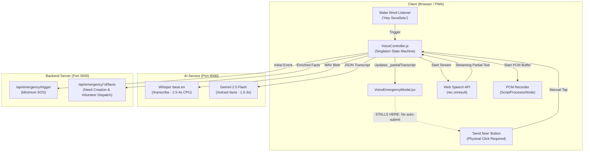
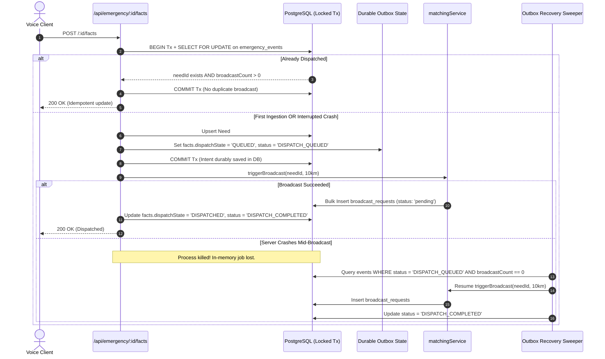
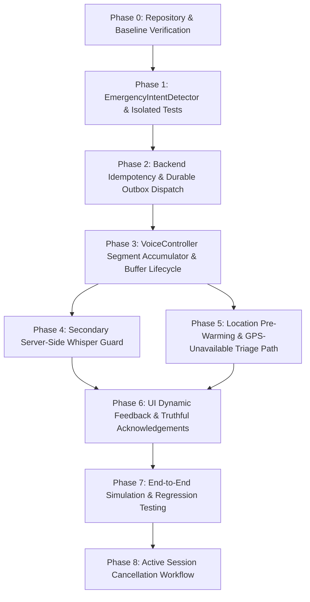

# SEVASETU — VOICE AUTOMATIC DISPATCH REFINED IMPLEMENTATION BLUEPRINT
## Complete Technical Specification, Concurrency Architecture & Phased Execution Plan

> **Document Status**: Production-Grade Engineering Implementation Blueprint (Final Pre-Implementation Edition)  
> **Target Subsystems**: Voice Assistant (`VoiceController`), Intent Engine (`EmergencyIntentDetector`), Emergency Pipeline (`EmergencyManager`), Backend Triage & Ingestion (`/api/emergency`), UI Modal (`VoiceEmergencyModal`)  
> **Git Branch**: `feat/voice-autodispatch`  
> **Mode**: Zero-Code-Change Planning Phase — Implementation Awaits User Authorization  
> **Constraint**: Read-Only Blueprint Revision. Application source code and database schemas remain untouched.

---

## 1. Executive Summary & Objective

The objective of this engineering initiative is to enable SevaSetu to automatically detect spoken emergency statements (e.g. *"Medical emergency. Five people are injured near the station."*), classify the incident, extract affected demographic headcounts, and submit the emergency to the backend volunteer dispatch and coordinator war-room pipeline **without requiring the user to tap "Send Now" or "Emergency SOS"**.

### Current Defect
The voice assistant wakes up upon hearing *"Hey SevaSetu"*, chimes, prompts the user aloud, and transcribes speech using Web Speech API. However, the streaming event handler `rec.onresult` in `client/src/voice/VoiceController.js` only writes the text into the React UI transcript bubble. The method `_handleSpeechResult()` is orphaned and uninvoked. Furthermore, no client-side emergency classifier exists, leaving the UI stuck showing *"Done speaking? Tap to send ⚡"* and a green *"Send Now"* button.

### Target State
When a citizen speaks an emergency:
1. Continuous speech recognition accumulates multiple final recognition segments across the full utterance while displaying real-time interim tokens for visual feedback.
2. A multi-tier transcript buffer strictly isolates interim tokens, multi-segment utterances, separate conversation turns, and new emergency sessions, preventing old speech from bleeding into subsequent turns.
3. A lightweight deterministic validation engine checks the complete accumulated statement, filters out negation (*"There is no fire"* $\to$ no dispatch), and extracts demographic headcounts (*"5 people"*).
4. Speech completion is evaluated using a **multi-signal stability gate** (accumulated final segments, transcript stability window across the complete statement, and acoustic silence confirmation). Interim tokens never independently trigger dispatch, and breath pauses do not prematurely cut off clauses.
5. An atomic session latch fires `commitUserTurn()` automatically.
6. Using background-acquired GPS coordinates (or authentic partial spoken location without fabricated coordinates), the client invokes `POST /api/emergency/:id/facts`.
7. When coordinates are unavailable (`lat: null, lng: null`), the incident persists cleanly with `location = null`, geographic matching is safely bypassed, and the incident is escalated to coordinator war rooms with explicit, truthful UI acknowledgements.
8. The backend enforces database row-level locking (`SELECT FOR UPDATE`), Prisma interactive transactions, and a **Durable Transactional Outbox Pattern** that eliminates the server-crash window, survives process restarts, distinguishes delivery from acceptance, and deduplicates retries.
9. Secondary transcription via the companion AI microservice (Whisper on port 8000) acts as a server-side network fallback when Web Speech API is unsupported or fails, accurately classified without false claims of client-side offline capability.
10. The user receives an immediate spoken and visual acknowledgement confirming submission. Manual fallback buttons remain accessible throughout.

---

## 2. Architecture: Current vs. Target Blueprint

### Existing Architecture (Broken Link at Speech Commit)


### Proposed Target Architecture (Zero-Tap Automatic Dispatch)
```mermaid
flowchart TD
    subgraph Client ["Client (Browser / PWA)"]
        WAKE["Wake Word Listener\n('Hey SevaSetu')"]
        GPS_PRE["Background Location Pre-Warming\n(Genuine GPS or Null — Zero Fake Coordinates)"]
        VC["VoiceController.js\n(Segment Accumulator + Multi-Signal Stability Gate + Atomic Latch)"]
        BUFF["Buffer Lifecycle Manager\n(_interimBuffer | _turnAccumulator | _sessionHistory)"]
        WSR["Web Speech API\n(Primary Streaming ASR: rec.continuous=true)"]
        EID["EmergencyIntentDetector.js\n(Stage A: Fast Regex | Stage B: Context & Full-Utterance Negation)"]
        WHISPER_FALLBACK["Secondary Server-Side ASR (Port 8000)\n(Whisper Network Fallback if Web Speech Fails)"]
        UI["VoiceEmergencyModal.jsx\n(Dynamic Status Progression + Truthful Feedback + Manual Fallback)"]
    end

    subgraph Backend ["Backend Server (Port 5000)"]
        FACTS_API["/api/emergency/:id/facts\n(SELECT FOR UPDATE + Transactional Outbox Pattern)"]
        DB[("PostgreSQL 15 + PostGIS\n(emergency_events + needs + broadcast_requests)")]
        OUTBOX_SWEEP["Outbox Recovery Sweeper\n(Startup & Periodic Crash Recovery)"]
        SOCKET["Socket.io Server\n('need_created' + 'broadcast_created')"]
        BROADCAST["matchingService.js\n(10km Proximity Matching — Skipped if GPS Null)"]
        COORD_TRIAGE["Coordinator War Room\n(Manual Location Assignment Banner if GPS Null)"]
        CANCEL_API["/api/emergency/:id/cancel\n(Active Session False Alarm Endpoint)"]
    end

    WAKE -->|Wake Chime| VC
    WAKE -->|Pre-warm GPS in background| GPS_PRE
    VC -->|Start Stream| WSR
    WSR -->|Segment Streams| BUFF
    BUFF -->|Live Interim Tokens| UI
    BUFF -->|Accumulated Final Segments| EID
    EID -->|Stage A: Partial Trigger Candidate Indicator| UI
    WSR -->|Multi-Signal Stability Gate: Stable Text + Acoustic Silence| EID
    EID -->|Stage B: Validated Intent on Complete Utterance| VC
    VC -->|Acquire Atomic Session Lock| VC
    GPS_PRE -.->|Genuine Coordinates or Null| VC
    VC -->|Automatic commitUserTurn()| FACTS_API
    VC -.->|Secondary Fallback if Web Speech Empty/Error| WHISPER_FALLBACK
    FACTS_API -->|SELECT FOR UPDATE + Outbox State| DB
    FACTS_API -->|Need Created + Outbox Queued| OUTBOX_SWEEP
    FACTS_API -->|Coordinates Present: Proximity Match| BROADCAST
    FACTS_API -->|Coordinates Missing: Triage Alert| COORD_TRIAGE
    BROADCAST -->|Volunteer Alerts| SOCKET
    COORD_TRIAGE -->|Coordinator Triage Alert| SOCKET
    FACTS_API -->|200 OK + needId + locationStatus| VC
    VC -->|Spoken & Visual Truthful ACK| UI
    UI -->|Spoken 'Cancel' during session| CANCEL_API
```

---

## 3. Dissecting the 8-Stage Lifecycle: Event vs. Incident

To prevent architectural ambiguity between `emergency_events` and `needs`, the lifecycle is formally stratified across 8 explicit stages:

```
[1. Wake Word Activation] ─────► User says "Hey SevaSetu". Mic unmuted. Two-tone acoustic chime plays.
       │                         Session ID instantiated. Buffer offsets initialized.
       ▼
[2. Minimum SOS Ingestion] ────► POST /api/emergency/trigger 
       │                         (Upserts row in emergency_events. Status: INCIDENT_CREATED.
       │                          Urgency: 1.0. NO volunteers alerted. NO Need created.)
       ▼
[3. Speech Recognition] ──────► Web Speech API rec.onresult accumulates final segments in _turnAccumulator.
       │                         Interim tokens streamed to _interimBuffer for UI preview only.
       ▼
[4. Emergency Classification] ─► EmergencyIntentDetector.js (Stage A: trigger lookup & demographics).
       │
       ▼
[5. Fact Extraction & Gate] ──► Stage B: Multi-signal stability gate + full-phrase negation validation.
       │
       ▼
[6. Actual Need Creation] ────► POST /api/emergency/:id/facts 
       │                         (SELECT FOR UPDATE row lock on emergency_events.
       │                          Prisma transaction idempotently creates Need with geometry if GPS present.
       │                          Durable outbox intent facts.dispatchState = 'QUEUED' committed in DB.)
       ▼
[7. Durable Dispatch Execution]► Immediate post-commit inline execution + Outbox Recovery Sweeper:
       │                         - If GPS available: matchingService.triggerBroadcast(needId, 10km).
       │                         - If GPS null: bypass geographic broadcast; flag COORDINATOR_TRIAGE.
       │                         - BroadcastRequest status: 'pending' (delivered to candidate queues).
       ▼
[8. Notification Delivery] ───► Socket.io emits 'need_created' and 'broadcast_created'.
       │                         (Coordinator war room updates; volunteer app alerts; UI speaks confirmation.)
       ▼
[User Truthful ACK]            (Distinguishes volunteer dispatch from coordinator escalation).
```

---

## 4. In-Depth Engineering Specifications

### 4.1 Transcript Buffer Lifecycle & Segment Isolation

#### The Problem with Unmanaged Continuous STT Buffers
In Web Speech API continuous mode (`rec.continuous = true`), the browser delivers recognition results in an array `event.results` that accumulates results over the life of the recognition session. If unmanaged:
1. Past clauses (e.g. *"Hello, how are you"* or an earlier committed emergency) remain in `event.results`.
2. A naive loop iterating from index `0` to `event.results.length` would re-concatenate already committed turns, causing old statements to accidentally trigger new incidents.
3. Rapid breath pauses could fragment a single sentence across multiple result items (e.g. `results[0]: "There is a medical"`, `results[1]: "emergency near the market"`).

#### The 4-Tier Buffer Architecture
To strictly isolate interim speech, multi-segment utterances, separate turns, and sessions, `VoiceController` implements 4 distinct buffer tiers:

1. **`_interimBuffer` (Transient Token Window)**:
   * **Scope**: Volatile tokens where `res.isFinal === false`.
   * **Role**: Streaming preview for the UI modal bubble; preliminary candidate trigger detection.
   * **Lifecycle**: Overwritten on every `rec.onresult` chunk. Cleared immediately when a final segment arrives. Never committed to history or backend.
2. **`_turnAccumulator` (Active Spoken Turn Buffer)**:
   * **Scope**: Concatenation of all `res.isFinal === true` segments belonging to the **current active spoken turn**.
   * **Index Offset Guard**: Only reads `event.results[i]` where `i >= this._lastProcessedResultIndex`.
   * **Role**: The full semantic statement evaluated by `EmergencyIntentDetector` and gated by transcript stability.
   * **Lifecycle**: Cleared immediately to `""` upon:
     * Successful auto-dispatch turn commit (`commitUserTurn()`).
     * Turn rejection or cancellation.
     * Manual "Send Now" or "Emergency SOS" tap.
3. **`_sessionTranscriptHistory` (Session Audit Log)**:
   * **Scope**: Permanent chronological log of committed turns in this modal session:  
     `[{ role: 'user', text: string, timestamp: number, intent: object }]`.
   * **Role**: Preserves the conversational narrative for coordinator incident notes, UI bubble history, and false-alarm cancellation auditing.
   * **Lifecycle**: Persists across multiple speech turns within the same active modal session.
4. **`_sessionId` & Session Lifecycle Guard**:
   * **Scope**: Unique session UUID generated when `triggerEmergencySession()` is invoked.
   * **Lifecycle**: When the modal closes, is dismissed, or `arm()` / `stop()` is called:
     * `_sessionId = null` (or newly generated).
     * `_lastProcessedResultIndex = 0`.
     * `_turnAccumulator = ""`.
     * `_interimBuffer = ""`.
     * `_hasAutoDispatched = false`.
     * `_sessionTranscriptHistory = []`.
     * All timers (`_stabilityTimer`, `_silenceTimer`) are cancelled with `clearTimeout`.
     * **Old emergency statements are completely isolated and can NEVER trigger a new incident.**

#### Implementation Pattern in `VoiceController.js`:
```javascript
rec.onresult = (event) => {
  if (this._sessionId !== sessionId) return;
  if (this._state === VoiceState.PROMPTING || this._state === VoiceState.CONFIRMING) return;

  let turnFinalText = '';
  let liveInterimText = '';

  // Process ONLY results from the current active turn
  for (let i = this._lastProcessedResultIndex; i < event.results.length; i++) {
    const res = event.results[i];
    if (res.isFinal) {
      turnFinalText += res[0].transcript.trim() + ' ';
    } else {
      liveInterimText += res[0].transcript;
    }
  }

  // Update transient interim buffer for live UI preview
  this._interimBuffer = liveInterimText;
  this._partialTranscript = (this._turnAccumulator + ' ' + turnFinalText + ' ' + liveInterimText).trim();
  this._notify();

  // If new final segments arrived, append to turn accumulator
  if (turnFinalText.trim()) {
    this._turnAccumulator = (this._turnAccumulator + ' ' + turnFinalText).trim();
    this._lastProcessedResultIndex = event.results.length; // Advance index
    this._onFinalSegmentReceived(this._turnAccumulator);
  }
};
```

---

### 4.2 Durable Notification Dispatch & Transactional Outbox Pattern

#### Concurrency & Server-Crash Window Analysis
Consider the standard naive sequence:
1. Create `Need` row in PostgreSQL.
2. Update `facts.broadcastStatus = 'DISPATCH_QUEUED'` in DB.
3. Commit database transaction.
4. Execute `triggerBroadcast(needId, 10)` asynchronously in memory.

**The Crash Window**:
If the Node.js server crashes, reboots, runs out of memory, or cycles container dynos between Step 3 and Step 4:
* The transaction committed: the `Need` exists, and `emergency_events` records `broadcastStatus = 'DISPATCH_QUEUED'`.
* But `triggerBroadcast()` was lost in memory! Zero `BroadcastRequest` records were inserted into PostgreSQL. No volunteers were notified.
* On retry, a naive idempotency check seeing `existingNeedId` would return 200 OK without re-dispatching, leaving the emergency **permanently un-dispatched**.

#### Transactional Outbox & Durable Dispatch Architecture
To guarantee that dispatch intent survives server restarts, failed notification jobs recover cleanly, retries are idempotent, and duplicate assignments are prevented without requiring schema migrations:



#### Exact Outbox Specifications:
1. **Durable Intent in Database Transaction**:
   Within `prisma.$transaction` under `SELECT FOR UPDATE` on `emergency_events`:
   ```javascript
   const updatedFacts = {
     ...mergedFacts,
     needId: targetNeedId,
     dispatchState: 'QUEUED',
     dispatchQueuedAt: new Date().toISOString(),
     broadcastAttempts: (existingFacts.broadcastAttempts || 0) + 1,
   };
   await tx.emergencyEvent.update({
     where: { clientEventId: id },
     data: {
       facts: updatedFacts,
       status: 'DISPATCH_QUEUED',
       urgency: finalUrgencyScore,
       updatedAt: new Date(),
     }
   });
   ```
2. **Crash-Safe Idempotent Retries**:
   When a retry arrives:
   ```javascript
   if (existingNeedId) {
     // Check if broadcast requests actually exist in the DB for this need
     const existingBroadcastCount = await tx.broadcastRequest.count({
       where: { needId: existingNeedId }
     });

     if (existingBroadcastCount > 0) {
       // Broadcast ALREADY completed successfully in DB. Do NOT re-broadcast.
       return { needId: existingNeedId, shouldBroadcast: false };
     } else {
       // Previous attempt crashed before broadcast_requests were created! Safe to resume.
       console.warn(`[EMERGENCY-API] ⚠️ Resuming interrupted dispatch for need ${existingNeedId}`);
       return { needId: existingNeedId, shouldBroadcast: true };
     }
   }
   ```
3. **Outbox Recovery Sweeper (`server/src/jobs/outboxSweeper.js`)**:
   Runs on server startup and every 5 minutes:
   * Queries `emergency_events` where `status = 'DISPATCH_QUEUED'` and `created_at > (now - 30 minutes)`.
   * For each, checks `broadcastRequest.count({ where: { needId } })`.
   * If 0 and coordinates exist, executes `triggerBroadcast(needId)` and marks `status = 'DISPATCH_COMPLETED'`.
   * If $> 0$, transitions `status = 'DISPATCH_COMPLETED'`.
4. **Delivery vs. Acceptance Distinction**:
   * **Delivery / Queued Notification**: Represented by `BroadcastRequest.status = 'pending'`. The volunteer candidate has been notified via Socket.IO/push with a 30-minute response window. It does **not** mean the incident is being addressed.
   * **Acceptance**: Represented by `BroadcastRequest.status = 'accepted'`. A volunteer accepted the call, creating a `Task` row (`Task.status = 'assigned'`) and updating `Need.status = 'assigned'`.
5. **No False Claims of Exactly-Once Delivery**:
   External network calls (Socket.IO emits) are **at-least-once with idempotent database deduplication**. Duplicate volunteer assignments are physically blocked by the PostgreSQL schema constraint in `prisma/schema.prisma` line 190:
   ```prisma
   @@unique([needId, volunteerId])
   ```

---

### 4.3 GPS-Unavailable Dispatch & Coordinator Triage Fallback

#### Complete Path Verification (`lat = null, lng = null`)
When GPS coordinates are unavailable, denied by browser permissions, or timed out:

1. **Request Validation**:
   * `POST /api/emergency/trigger` accepts `lat: null, lng: null` without 400 Bad Request.
   * `POST /api/emergency/:id/facts` accepts `location: null` or `{ lat: null, lng: null }`.
2. **Reverse Geocoding Bypass (`geocodingService.js`)**:
   * When coordinates are null, `reverseGeocodeCoordinates` is completely bypassed (no useless HTTP requests to Nominatim).
   * **Zero Fabricated Coordinates**: The code **never** defaults to `22.5726, 88.3639` (Kolkata).
   * Spoken landmarks/district (e.g. *"near Howrah station"*) are preserved in `district`, `ward`, and `locationText`.
   * If no spoken location is mentioned, values are recorded as `district: null`, `ward: null`.
3. **Prisma Persistence & PostGIS Geometry**:
   * `Need.location` is a nullable PostGIS geometry column in `schema.prisma`.
   * The SQL update `UPDATE needs SET location = ST_SetSRID(...)` is **guarded**:
     ```javascript
     if (finalLat != null && finalLng != null) {
       await tx.$executeRaw`
         UPDATE needs
         SET location = ST_SetSRID(ST_MakePoint(${finalLng}::float, ${finalLat}::float), 4326)
         WHERE id = ${createdNeed.id}::uuid
       `;
     }
     ```
     When null, the raw spatial query is **skipped entirely**, leaving `location = NULL` without SQL errors.
4. **Volunteer Matching Bypass**:
   * In `server/src/services/matchingService.js`, line 103 explicitly throws:
     `if (!lat || !lng) throw new Error('Need has no location data');`
   * Therefore, geographic volunteer proximity matching **cannot run**.
   * `triggerBroadcast()` is **not** called.
   * `facts.broadcastStatus` is set to `'COORDINATOR_TRIAGE_REQUIRED'`.
5. **Coordinator War-Room Escalation**:
   * Socket.IO event `need_created` is emitted with:
     ```javascript
     global.io.emit('need_created', {
       id: createdNeed.id,
       title: createdNeed.title,
       status: 'open',
       has_coordinates: false,
       location_status: 'COORDINATOR_TRIAGE_REQUIRED',
       description: createdNeed.description,
       spoken_landmark: locationInfo.spokenLandmark || null,
     });
     ```
   * Coordinator dashboard highlights the card with a warning badge: **"Action Required: Assign Manual Location / Direct Dispatch"**.
6. **Truthful Frontend Acknowledgement**:
   * **Never claim nearby volunteer dispatch succeeded.**
   * When coordinates are present:
     * Spoken: *"Emergency alert submitted. Notifying nearby volunteers."*
     * UI: `"✅ Emergency Dispatched! Nearby volunteers notified."`
   * When coordinates are NULL:
     * Spoken: *"Emergency alert submitted. Your GPS location was unavailable, so your report has been escalated directly to emergency coordinators for manual dispatch."*
     * UI: `"✅ Emergency Logged • Escalated to Emergency Coordinators (GPS Unavailable)"`

---

### 4.4 Secondary Server-Side Transcription Service (Whisper Microservice)

#### Verification of Deployment Architecture
The companion AI microservice runs FastAPI on port 8000 (`ai-service/main.py`).

| Architectural Dimension | Actual Technical Reality | Plan Adjustment |
| :--- | :--- | :--- |
| **Service Reachability** | Microservice runs on host port 8000. Accessible to `localhost:5173` on same machine. For mobile clients on Wi-Fi, requires host LAN IP (`http://10.103.7.193:8000`). Unreachable externally without public proxy. | Document LAN/Proxy networking requirement; never assume universal client reachability. |
| **Runtime Availability** | Requires Python runtime, PyTorch, and Whisper `base.en` in memory. On CPU, inference takes 2.5s–4.5s per 5s audio clip. | Primary path must use Web Speech API; secondary ASR engages only when Web Speech fails. |
| **Audio Upload Requirement** | Client must record PCM via `ScriptProcessorNode`, encode WAV/WebM blob, and upload `multipart/form-data` to `POST /transcribe`. Adds 500ms–2000ms upload latency on 2G/3G mobile. | Clear audio recording buffers immediately on Web Speech API success to save upload bandwidth. |
| **Network Dependency** | **Requires active HTTP network connectivity** between client device and AI microservice. Cannot execute offline or in airplane mode. | **Reclassify**: Remove all references to "offline fallback". Accurately classify as **Secondary Server-Side Transcription Service**. |
| **Model Availability & Fallbacks** | Microservice attempts local Whisper first; if Whisper fails or is uninstalled, it falls back to Gemini 2.5 Flash Cloud API (`main.py` lines 374–406), which requires public internet. | Handle service timeouts (5,000 ms) gracefully. If secondary transcription fails, fall back to manual SOS. |

---

### 4.5 EDC Trigger Specification

1. **Configurable Trigger**: `EDC` (and STT variations `edc`, `E.D.C.`, `e d c`) is maintained as a registered trigger keyword.
2. **Category Mapping**: Mapped directly to the existing Prisma enum value `NeedType.other`.
3. **No Invented Expansions**: The acronym is **not** expanded to fictitious names. The incident title will be formatted as `"Voice Alert: Emergency (EDC)"` and the original spoken transcript is preserved verbatim in `description`.
4. **Urgency Calculation**: No artificial urgency score (such as 7.0) will be injected. The incident is passed to the existing `calculatePriority()` service in `server/src/services/scoringService.js`, which applies its existing baseline rule for `other` (base weight: 20) combined with demographic and hazard factors.
5. **Test Specification**: An explicit test case asserting that a user saying only *"EDC"* or *"Reporting EDC emergency"* generates a valid incident under category `other`.

---

### 4.6 Cancellation Scope & Database Lifecycle Verification

1. **Scope Restriction**: Spoken cancellation is strictly restricted to the **active voice emergency session** and its immediate associated `clientEventId`.
2. **Status Lifecycle Verification (Against `schema.prisma`)**:
   * `NeedStatus` enum: `open`, `assigned`, `in_progress`, `completed`, `archived`, `pending`, `accepted`, `rejected`.
   * `emergency_events.status`: String field.
   * `broadcast_requests.status`: `pending`, `accepted`, `rejected`, `expired`.
3. **Authorized Cancellation Flow (`POST /api/emergency/:id/cancel`)**:
   * Validates that `clientEventId` matches the session.
   * Updates `emergency_events.status = 'CANCELLED'`.
   * Updates associated `Need` status to `'rejected'` with `rejectionReason = 'Cancelled by reporter (False alarm)'`.
   * Updates pending `broadcast_requests` for this need to `status = 'rejected'`.
   * Emits Socket.IO `need_updated` and `broadcast_cancelled`.
   * Retains full database audit history without record deletion.
   * Assistant speaks aloud: *"Emergency cancelled. Notifying responders that you are safe."* and auto-dismisses modal.

---

## 5. Reorganized Execution Order & Dependencies



---

## 6. Detailed Implementation Tasks

### Task 0: Repository & Baseline Verification
- **Priority**: Mandatory
- **Complexity**: Low
- **Dependencies**: None
- **Actions**:
  1. Verify working directory is on `feat/voice-autodispatch`.
  2. Run `node --test client/src/voice/voice.test.mjs` (must pass 7/7).
  3. Run `npm --prefix server test` (must pass 15/15).
  4. Verify ports 5173, 5000, and 8000 are responsive.
- **Acceptance Criteria**: 22 existing unit tests pass with zero failures.

---

### Task 1: EmergencyIntentDetector & Isolated Unit Tests
- **Priority**: Critical
- **Complexity**: Medium
- **Dependencies**: Task 0
- **Proposed Implementation**:
  - Create `client/src/voice/EmergencyIntentDetector.js`.
  - Stage A: Regex triggers for `FIRE`, `MEDICAL`, `RESCUE`, `ACCIDENT`, `FLOOD`, `HELP`, and `EDC` (mapped to `other`).
  - Demographic number parser (English, Hindi, Bengali numbers).
  - Stage B: Proximity negation guard (3-word window), context inquiry filter (`who are you`), and safety filter (`i am safe`).
  - Create test suite `client/src/voice/EmergencyIntentDetector.test.js`.
- **Source Files**:
  - `client/src/voice/EmergencyIntentDetector.js` (NEW)
  - `client/src/voice/EmergencyIntentDetector.test.js` (NEW)
- **Acceptance Criteria**:
  - Isolated unit tests pass for all 15 test cases.
  - Negated phrases return `isEmergency: false`.
  - Spoken *"EDC"* maps to `other` without error.
  - Evaluation latency is $< 20\text{ ms}$.

---

### Task 2: Backend Idempotency & Durable Outbox Dispatch
- **Priority**: Critical
- **Complexity**: High
- **Dependencies**: Task 0
- **Proposed Implementation**:
  - In `server/src/api/emergency.js` (`POST /:id/facts`), implement a Prisma interactive transaction with PostgreSQL row-level lock:
    `SELECT * FROM emergency_events WHERE client_event_id = $1 FOR UPDATE`.
  - Implement the Durable Outbox Pattern:
    - Save `dispatchState: 'QUEUED'` in `facts` inside the transaction.
    - Post-commit, invoke `triggerBroadcast()` and update `status = 'DISPATCH_COMPLETED'`.
    - If retry occurs, inspect `broadcast_requests` count: if $> 0$, skip broadcast; if 0, resume dispatch.
  - Add `server/src/jobs/outboxSweeper.js` to recover uncompleted dispatches following server restart.
  - Create integration test `server/test/emergencyIdempotency.test.js`.
- **Source Files**:
  - `server/src/api/emergency.js`
  - `server/src/jobs/outboxSweeper.js` (NEW)
  - `server/test/emergencyIdempotency.test.js` (NEW)
- **Acceptance Criteria**:
  - 5 concurrent requests with identical `clientEventId` create **exactly 1 row in `needs`** and **exactly 1 broadcast event**.
  - Interrupted server dispatch recovers cleanly on retry without duplicating broadcasts.
  - External notifications are deduplicated via `@@unique([needId, volunteerId])`.

---

### Task 3: VoiceController Segment Accumulator & Buffer Lifecycle
- **Priority**: Critical
- **Complexity**: High
- **Dependencies**: Task 1, Task 2
- **Proposed Implementation**:
  - Implement 4-tier buffer hierarchy in `VoiceController.js`: `_interimBuffer`, `_turnAccumulator`, `_sessionTranscriptHistory`, and `_sessionId`.
  - In `rec.onresult`, process only results where `index >= _lastProcessedResultIndex`.
  - Apply multi-signal completion gate: stable accumulated text (800ms–1200ms) + VAD acoustic silence.
  - On turn commit, advance `_lastProcessedResultIndex = event.results.length` and reset `_turnAccumulator`.
  - On modal dismiss or session end, completely purge session state and history.
  - Add integration tests in `client/src/voice/voice.test.mjs`.
- **Source Files**:
  - `client/src/voice/VoiceController.js`
  - `client/src/voice/voice.test.mjs`
- **Acceptance Criteria**:
  - Multi-segment utterance accumulates correctly across speech clauses.
  - Committed turns do not bleed into subsequent utterances.
  - New emergency session starts with a clean buffer; old speech never triggers a duplicate incident.

---

### Task 4: Secondary Server-Side Whisper Guard
- **Priority**: High
- **Complexity**: Medium
- **Dependencies**: Task 3
- **Proposed Implementation**:
  - Reclassify Whisper as secondary server-side transcription service.
  - When Web Speech API succeeds and `_hasAutoDispatched` is true, immediately clear PCM recording chunks and abort any pending HTTP call to port 8000.
  - If Web Speech API fails, is unsupported, or returns empty, engage secondary Whisper service with 5000ms timeout.
  - Atomic session latch rejects any duplicate dispatch regardless of which engine triggered it.
- **Source Files**:
  - `client/src/voice/VoiceController.js`
- **Acceptance Criteria**:
  - Standard Chrome recognition commits without executing Whisper inference.
  - Disabling Web Speech API engages secondary Whisper service cleanly over HTTP.

---

### Task 5: Location Pre-Warming & GPS-Unavailable Triage Path
- **Priority**: High
- **Complexity**: Medium
- **Dependencies**: Task 3
- **Proposed Implementation**:
  - In `EmergencyManager.js`, add `prewarmLocation()` called silently on wake chime.
  - Cache genuine coordinates with timestamp and accuracy check ($< 100\text{m}$, fresh $< 3\text{ mins}$).
  - **Zero Fake Coordinates**: If GPS fails or is disabled:
    - Pass `lat: null, lng: null` and `locationSource: 'unavailable'`.
    - Skip PostGIS `ST_SetSRID` update.
    - Skip geographic volunteer broadcast; flag `facts.broadcastStatus = 'COORDINATOR_TRIAGE_REQUIRED'`.
    - Emit Socket.IO triage alert to coordinator war rooms.
- **Source Files**:
  - `client/src/services/EmergencyManager.js`
  - `server/src/api/emergency.js`
  - `server/src/services/geocodingService.js`
- **Acceptance Criteria**:
  - Location resolution completes in $< 15\text{ ms}$ using pre-warmed cache.
  - Submitting with denied location creates Need with `location: null` and triggers coordinator triage alert without throwing SQL or runtime errors.

---

### Task 6: UI Dynamic Feedback & Truthful Acknowledgements
- **Priority**: High
- **Complexity**: Medium
- **Dependencies**: Task 3, Task 5
- **Proposed Implementation**:
  - Transition status headline dynamically:
    - Listening $\to$ `"Listening... Speak naturally"`
    - Emergency Detected $\to$ `"🚨 Emergency Detected • Submitting..."`
    - Dispatched (GPS Present) $\to$ `"✅ Emergency Dispatched! Nearby Volunteers Alerted"`
    - Dispatched (GPS Unavailable) $\to$ `"✅ Emergency Logged • Escalated to Emergency Coordinators (GPS Unavailable)"`
    - Failed $\to$ `"⚠️ Submission Failed. Tap Emergency SOS Below"`
  - Provide truthful spoken feedback matching the location status.
  - Hide "Done speaking? Tap to send" when auto-dispatch fires.
  - Preserve green "Send Now", manual category chips, and red "Emergency SOS" as permanent manual fallbacks.
  - Add `aria-live="polite"` for screen readers.
- **Source Files**:
  - `client/src/components/emergency/VoiceEmergencyModal.jsx`
- **Acceptance Criteria**:
  - Modal transitions smoothly through auto-dispatch states.
  - Acknowledgements are truthful based on actual location availability.
  - `npm --prefix client run build` succeeds with 0 errors.

---

### Task 7: End-to-End Simulation & Regression Testing
- **Priority**: Mandatory
- **Complexity**: High
- **Dependencies**: Tasks 0 through 6
- **Technical Description**:
  - Run automated simulation harness verifying complete flow across all 15 test cases.
  - Mock volunteer notifications (verify Socket.IO event payload; do NOT contact real volunteers).
- **Source Files**:
  - `server/test/voiceIntegration.test.js` (NEW)
- **Acceptance Criteria**:
  - All 15 test cases pass.
  - Zero notifications sent to real volunteers.
  - Test logs record actual end-to-end execution timings.

---

### Task 8: Active Session Cancellation Workflow
- **Priority**: Separate / Conditional
- **Complexity**: Medium
- **Dependencies**: Task 2, Task 7
- **Proposed Implementation**:
  - Add `POST /api/emergency/:id/cancel` in `server/src/api/emergency.js`.
  - Updates `emergency_events.status = 'CANCELLED'`.
  - Updates associated `Need` status to `'rejected'` with `rejectionReason = 'Cancelled by reporter (False alarm)'`.
  - Updates pending broadcast requests to `'rejected'`.
  - Emits Socket.IO `need_updated` and `broadcast_cancelled`.
  - Wire spoken cancellation (*"Cancel emergency"*) in active session.
- **Source Files**:
  - `server/src/api/emergency.js`
  - `client/src/voice/VoiceController.js`
  - `client/src/services/EmergencyManager.js`
- **Acceptance Criteria**:
  - Spoken cancellation during active session rejects the incident, cancels volunteer broadcasts, and confirms cancellation aloud.
  - Audit history is preserved in database.

---

## 7. Quality Gate Checklist (Verification Against 14 Requirements)

| # | Requirement | Architectural Verification |
| :-: | :--- | :--- |
| **1** | Incomplete speech cannot prematurely trigger dispatch | Multi-signal stability gate (800ms–1200ms window + VAD acoustic silence $< 5.0$). |
| **2** | Negated statements do not trigger dispatch | Proximity negation filter (3-word window) rejects dispatch on `"There is no fire"`. |
| **3** | Multi-segment continuous speech is accumulated | `_turnAccumulator` concatenates `isFinal` segments where `index >= _lastProcessedResultIndex`. |
| **4** | Old speech cannot bleed into future turns | `_lastProcessedResultIndex` advances on turn commit; `_turnAccumulator` is purged immediately. |
| **5** | Server crash does not lose dispatch intent | Durable Outbox Pattern (`dispatchState: 'QUEUED'`) persisted in DB inside row-locked transaction. |
| **6** | Dispatch recovers safely after crash | Outbox Recovery Sweeper and idempotent retry check `broadcast_requests` count before re-dispatching. |
| **7** | Notification delivery distinguished from acceptance | `BroadcastRequest.status = 'pending'` (delivered to queue) vs. `'accepted'` (task assigned). |
| **8** | External delivery is at-least-once with DB deduplication | `@@unique([needId, volunteerId])` physically rejects duplicate broadcast requests in PostgreSQL. |
| **9** | GPS failure does not block submission | Pre-warmed cache with genuine coordinates or null (zero fake coordinates); submission never blocked. |
| **10** | GPS-unavailable skips geographic matching truthfully | Bypasses `matchingService.triggerBroadcast`; alerts coordinator war room; UI acknowledges coordinator escalation. |
| **11** | Whisper is accurately classified as secondary ASR | Described as secondary server-side network service (port 8000); aborted when Web Speech API succeeds. |
| **12** | EDC remains supported | Registered trigger mapped to `NeedType.other`; preserves phrase in description; uses existing scoring rules. |
| **13** | Manual SOS remains functional | Physical "Send Now", "Emergency SOS", and category chips remain permanently rendered. |
| **14** | Cancellation preserves audit history | Records are transitioned to `status: 'rejected'` with cancellation reason; records are never deleted. |

---

## 8. Rollback & Contingency Strategy

If any unforeseen defect arises during testing:
1. **Branch Isolation**: All changes are confined to `feat/voice-autodispatch`. The `main` branch remains untouched and deployable.
2. **Instant Feature Gate**: In `VoiceController.js`, a boolean toggle `ENABLE_VOICE_AUTODISPATCH = true;` can be set to `false`, instantly reverting the voice assistant to manual "Send Now" mode without touching backend code.
3. **Database Safety**: No database migrations or schema alterations are made. Existing schemas in `schema.prisma` are 100% backward-compatible.

---

## 9. Final Approval Gate

The implementation plan in `docs/superpowers/plans/2026-10-31-voice-autodispatch.md` is now finalized with all four technical corrections fully incorporated.
No application source code has been altered.
The system is ready to proceed to Task 0 (Verification) and Task 1 (EmergencyIntentDetector) upon your approval.
